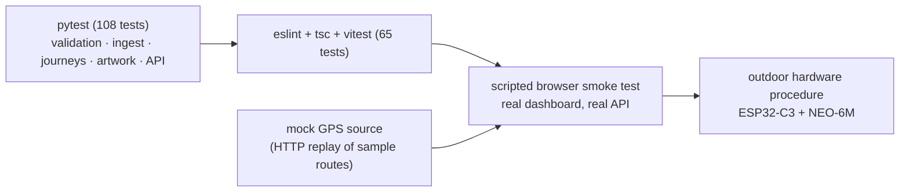

# Testing GeoSketch

Three layers are tested separately, because they fail for different reasons: the **backend**
(pure logic + HTTP), the **frontend** (lint + types + unit tests + scripted browser run) and the
**hardware** (the only part that needs sky visibility and cannot be faked honestly).



| Layer | Command | Hardware needed |
| --- | --- | --- |
| Backend lint | `cd backend && ruff check app tests` | No |
| Backend | `cd backend && .venv\Scripts\python -m pytest -q` (coverage gate ≥ 85 %) | No |
| Frontend lint | `cd frontend && npm run lint` | No |
| Frontend types/build | `cd frontend && npm run typecheck && npm run build` | No |
| Frontend unit tests | `cd frontend && npm run coverage` (vitest, coverage gate) | No |
| Browser UI | `npm run ui:smoke` (debug Chrome required) | No |
| Device ingest | firmware + serial monitor, or the mock GPS client below | Yes, for the real thing |
| Outdoor acceptance | [`hardware procedure`](#4-outdoor-hardware-test-procedure) | **Yes** |

---

## 1. Backend test suite (108 tests)

`pytest` runs against an isolated SQLite database created per test session
(`tests/conftest.py`), so it never touches your `geosketch.db` or your real artwork exports.

```powershell
cd backend
.venv\Scripts\python -m pytest -q            # 108 passed
.venv\Scripts\python -m pytest -v            # per-test names
.venv\Scripts\python -m pytest tests/test_artwork.py -q
```

| File | Tests | Proves |
| --- | --- | --- |
| `tests/test_geo.py` | 21 | Haversine distance (known city pairs), bearing, coordinate/timestamp validation, local projection, normalisation with aspect ratio preserved. |
| `tests/test_segmentation.py` | 10 | Gap detection, implausible-jump detection, redundant-point removal, segment reconstruction — the shared rules used by statistics *and* artwork. |
| `tests/test_ingest.py` | 17 | Payload parsing, missing/invalid coordinates, out-of-range values, duplicate `client_point_id` suppression, paused-journey handling, device authentication (401/403), source mixing refusal. |
| `tests/test_journeys.py` | 23 | Full recording state machine, invalid transitions → 409, save/clear rules, statistics (distance, duration, moving time, average speed) and persistence ordering. |
| `tests/test_artwork.py` | 18 | Style catalogue, all five styles, customisation (colours/line width/title/markers), SVG + PNG output validity, empty/short route edge cases, reproducible metadata. |
| `tests/test_demo_and_api.py` | 19 | Sample route loading, demo provenance isolation, instant import, health/banner endpoints, consistent error bodies, request-size and rate limiting. |

Note: a `StarletteDeprecationWarning` about `httpx` appears on some versions when using
`fastapi.testclient`. It is a warning from the framework, not a failing test.

### Mock GPS strategy (no hardware)

Hardware-free development uses two interchangeable stand-ins:

1. **DEMO MODE** (UI/API) — `POST /api/v1/demo/routes/{id}/import` stores a finished demo
   journey; `POST /api/v1/journeys/{id}/points` (replay) streams points into a demo journey.
2. **A scripted device client** — post fixes through the *real* authenticated ingestion endpoint
   with sample-route coordinates, exactly as the firmware does:

```python
import json, urllib.request, time

API = "http://127.0.0.1:8000/api/v1/gps/points"
route = json.load(open("../data/sample_routes/riverfront_walk.json"))["points"]
journey = json.loads(urllib.request.urlopen(urllib.request.Request(
    "http://127.0.0.1:8000/api/v1/journeys",
    data=json.dumps({"title": "Mock GPS walk", "source": "device"}).encode(),
    headers={"Content-Type": "application/json"}, method="POST")).read())["id"]

for index, point in enumerate(route):
    body = json.dumps({
        "latitude": point["latitude"], "longitude": point["longitude"],
        "altitude": point.get("altitude"), "speed_kmh": point.get("speed_kmh"),
        "satellites": point.get("satellites", 9),
        "timestamp": point["timestamp"], "journey_id": journey,
        "client_point_id": f"mock:{index}",
    }).encode()
    request = urllib.request.Request(API, data=body, method="POST", headers={
        "Content-Type": "application/json",
        "X-Device-Id": "geosketch-01",
        "X-Device-Key": "<your-device-key>",
    })
    result = json.loads(urllib.request.urlopen(request).read())
    print(index, result["stored"], result["reason"] or "")
    time.sleep(0.05)
```

**What this mock can and cannot prove.** It exercises authentication, validation, duplicate
handling, ordering, statistics, the map and artwork — i.e. everything downstream of the UART.
It cannot prove NMEA parsing, satellite acquisition, fix quality or Wi-Fi behaviour on the
device. Only the outdoor procedure covers those, and the mock is used with `source: "device"`
journeys *only for development* — it must never be presented as a hardware recording in a demo.

### API error handling

The suite asserts the consistent error contract on every route group:

```json
{ "error": { "code": "invalid_transition", "message": "…", "current_status": "stopped" } }
```

422 (validation), 401/403 (device auth / ownership), 404 (unknown journey/artwork/route),
409 (invalid state transition, saving twice, deleting a saved journey), 413 (request too large),
429 (rate limited).

---

## 2. Frontend checks

```powershell
cd frontend
npm run lint          # eslint (typescript-eslint + react-hooks + react-refresh)
npm run typecheck     # tsc --noEmit, strict
npm run test          # vitest unit tests (jsdom + testing-library)
npm run coverage      # unit tests + v8 coverage, enforces the thresholds below
npm run build         # production bundle -> dist/
```

The type checks catch drift between the API responses and the UI
(`src/types/index.ts` mirrors the Pydantic schemas); linting and the unit tests catch logic
regressions before the browser.

### Frontend unit tests (65 tests)

Pure logic and the API layer are tested directly; presentational components are covered by the
browser smoke test instead.

| File | Tests | Proves |
| --- | --- | --- |
| `src/utils/geo.test.ts` | 17 | Haversine distance, bearing, drawability (rejects 0,0 / implausible), route segmentation on gaps and jumps, distance, bounds, direction arrows, timestamp shifting. |
| `src/utils/format.test.ts` | 16 | Distance/duration/speed/coordinate/count formatting, relative time, status labels, invalid-input fallbacks. |
| `src/services/api.test.ts` | 8 | Typed `fetch` client: JSON parsing, 204 handling, error-envelope → `ApiError`, network-error wrapping, query-string building, JSON request bodies. |
| `src/hooks/useToasts.test.tsx` | 5 | Toast queue cap (4), manual and timed dismissal (info 4 s / error 9 s). |
| `src/hooks/useDeviceStatus.test.tsx` | 2 | Polling load path and error path (mocked API). |
| `src/hooks/useJourney.test.tsx` | 3 | Null-journey reset, detail + statistics load, polling failure. |
| `src/hooks/useRecorder.test.tsx` | 9 | Start (adopt device journey / resume paused / create new), pause/resume/stop/save/clear/rename, 409 surfaced as "Command refused", no-journey guard. |
| `src/hooks/useDemoReplay.test.tsx` | 4 | 60× replay streaming, auto-stop at the end, empty-route refusal, stream failure, re-entrancy guard. |

Coverage is measured for `src/utils`, `src/hooks` and `src/services` (the logic layer). The gate
in `vite.config.ts` requires statements ≥ 75 %, branches ≥ 70 %, functions ≥ 70 %, lines ≥ 75 %
(currently ≈ 91 / 81 / 78 / 92 %).

## 3. Browser smoke test (no extra npm dependency)

`frontend/scripts/ui-smoke-test.mjs` drives the **real dashboard in a real browser** through the
Chrome DevTools Protocol and asserts what a human would do: recording start/pause/resume/stop/
save, DEMO MODE replay + instant import, artwork preview/generation/download, journey history,
map rendering and the device status card.

```powershell
# 1. backend must be running (:8000) and the dev server (:5173)
cd frontend && npm run dev

# 2. start a debug Chrome (separate terminal)
& "C:\Program Files\Google\Chrome\Application\chrome.exe" --headless=new `
    --remote-debugging-port=9222 --user-data-dir="$env:TEMP\geosketch-chrome" `
    http://127.0.0.1:5173

# 3. run the checks
npm run ui:smoke
# or: node scripts/ui-smoke-test.mjs [dashboardUrl] [debugPort]
# env: GEOSKETCH_API, GEOSKETCH_DEVICE_ID, GEOSKETCH_DEVICE_KEY
```

Two implementation notes that cost real debugging time and are therefore documented in the
script: Chrome's `innerText` applies `text-transform: uppercase` (so labels are matched on a
lower-cased copy), and Leaflet is configured with `preferCanvas`, so the route is drawn on a
`<canvas>` rather than in SVG `path` elements. Assert on the canvas/overlay state, not on SVG
children.

**Known limitation of this harness:** Chrome throttles `setInterval` in background/hidden tabs,
so a demo replay stalls while the page is not visible and resumes when you bring it back
(the replay derives progress from wall-clock time, so nothing is lost). Call
`Page.bringToFront` (or keep the window visible) when scripting a replay.

---

## 4. Outdoor hardware test procedure

Run top to bottom with the device outdoors; each step states its pass condition. Record the
date, weather, satellite count/HDOP, and a distance comparison against a phone GPS app.

| # | Step | Pass condition |
| --- | --- | --- |
| 1 | **Wiring** — power off, recheck TX→GPIO4, RX→GPIO5 (optional), GND→GND, VCC→3V3/5V against your board's pinout. | No heat/smoke; the GPS module's LED blinks. |
| 2 | **Serial, no Wi-Fi** — flash with a blank `GEOSKETCH_WIFI_SSID`. | Log shows `waiting for fix …` with a rising satellite count, then `fix acquired lat=… lon=…`. |
| 3 | **Cold start** — time from power-on to first fix, outdoors. | < 60 s (hot start: a few seconds). |
| 4 | **Coordinate accuracy** — compare the reported fix with a phone map. | Within a few metres of your actual position. |
| 5 | **Movement** — walk 20 m. | Coordinates change accordingly; `speed` plausible when moving, ≈ 0 standing still. |
| 6 | **Quality gate** — watch the gate counters while walking under trees/buildings. | Fixes with `sats < 4` or `hdop > 8` are *not* transmitted; `rejects` increments. |
| 7 | **Wi-Fi + ingest** — set the LAN IP in `config.h`, reflash. | `[POST] … -> 201 stored=true`; the dashboard shows the fix within ~1 s. |
| 8 | **Recording** — Start → walk ~200 m → Stop → Save. | The map shows only the walked track; distance within ~10–15 % of a phone app; no line across a break. |
| 9 | **Outage** — walk out of Wi-Fi range for ~1 minute, return. | `buffered=…` grows then drains to 0; the missed points appear in order with a gap, no teleport line. |
| 10 | **Duplicate safety** — restart the backend mid-walk. | No point is stored twice (`duplicate: true`); sequence numbers keep increasing. |
| 11 | **Reconnect** — power-cycle the router or the device. | The firmware logs `Reconnecting` and resumes posting without a reflash. |
| 12 | **Artwork** — generate all five styles from the walk, download PNG + SVG. | Artwork resembles the walked route; PNG opens in a viewer; SVG scales clearly. |
| 13 | **Evidence** — capture the serial log, screenshots of the map, statistics and artwork. | Ready for the project report. |

Steps 1–6 need only the device + serial monitor. Steps 7–12 additionally need the backend and
frontend running, with the PC on the same LAN.

**Which tests still require physical hardware (honest checklist):** NMEA reception and parsing
from the module, fix acquisition/quality, the on-device quality gate and deduplication,
UART pin/baud wiring, Wi-Fi association and reconnect, the RAM buffer/retry behaviour during a
real outage, power/battery behaviour, and long-duration (hour-scale) recording stability.
Everything else is covered by the automated suites above.

## 5. Regression checklist before a demo

```powershell
cd backend  ; ruff check app tests ; .venv\Scripts\python -m pytest -q   # lint clean; 108 passed, coverage ≥ 85%
cd ..\frontend ; npm run lint ; npm run typecheck ; npm run coverage ; npm run build
npm run ui:smoke                                             # all PASS
```

Then, with the hardware on the bench: steps 2, 7 and 8 above (about five minutes) — they are the
fastest way to prove the physical path still works before an audience.
